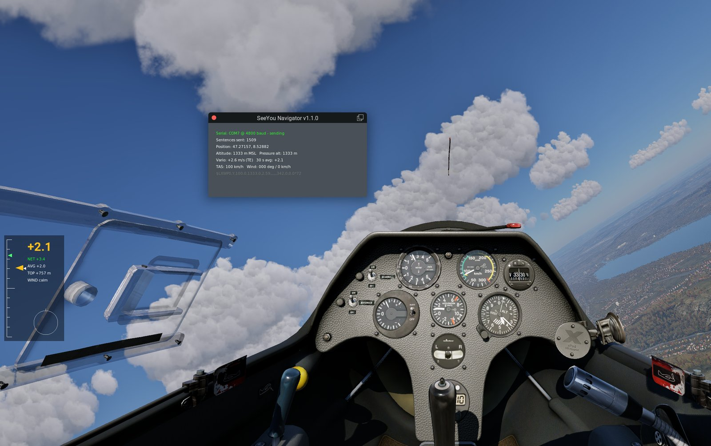

# X-Plane 12 SeeYou Navigator Integration



Bridge that connects [X-Plane 12](https://www.x-plane.com/) to [SeeYou Navigator](https://naviter.com/seeyou-navigator/) through a serial COM port and the [Naviter USB dongle](https://naviter.com/) (Silicon Labs CP210x).

The bridge reads the aircraft state from X-Plane, turns it into NMEA sentences and writes them to the dongle, the same way Condor 3 does. SeeYou Navigator on your phone treats X-Plane as if it were Condor.

Port of [afs4-seeyou-navigator-integration](https://github.com/jlgabriel/afs4-seeyou-navigator-integration) (Aerofly FS4) to X-Plane 12.

It comes in two forms that send exactly the same data:

| | XPPython3 plugin | Standalone app |
|---|---|---|
| Runs | Inside X-Plane | Next to X-Plane (or on another PC) |
| Needs | [XPPython3](https://xppython3.readthedocs.io/) + pyserial | Python 3.8+ + pyserial, or the .exe |
| Starts | With X-Plane, nothing to launch | You start it and click Start |
| Position precision | Full (double) | ~1 m (UDP sends float32) |
| Controls | Plugins menu + status window | Tkinter window |

## Features

- Position, altitude, ground speed and track to SeeYou Navigator
- **Total energy vario** from X-Plane's TE gauge (falls back to raw vertical speed if the aircraft has none)
- **Real TAS and wind** straight from X-Plane, no estimation
- **Simulator time** in the NMEA sentences, like Condor 3
- Output identical in format to Condor 3 (verified against a capture, byte for byte)
- **Plugin version**: starts with X-Plane, controlled from the Plugins menu, never stalls the sim (serial writes run on their own thread)
- **Standalone version**: zero X-Plane setup (no plugin, no Data Output settings); it asks X-Plane for the datarefs it needs, and X-Plane can run on another PC of the local network
- Detects the Naviter dongle (CP210x) automatically and remembers the last settings
- GUI with live flight data, terminal mode, and a dry-run mode that prints the NMEA
- Fake X-Plane (`tools/fake_xplane.py`) to try everything without starting the simulator

## Requirements

- **X-Plane 12**
- **Naviter USB dongle** connected to the PC, and **SeeYou Navigator** paired with it
- Plugin: **XPPython3** with **pyserial** installed in its Python
- Standalone app: **Python 3.8+** and **pyserial** (`pip install pyserial`). X-Plane 11 also works, since it uses the classic UDP protocol

## Data flow

```
X-Plane 12
     │  plugin: datarefs read in the flight loop (10 Hz)
     │  standalone: UDP 49000, RREF dataref subscription (10 Hz)
     │
     │  position, altitude, speed, TE vario, TAS, wind, zulu time
     ▼
xp12_seeyou (shared core)
     ├─ $GPGGA  position + altitude MSL
     ├─ $GPRMC  position + ground speed + track
     └─ $LXWP0  TAS + baro altitude + vario + heading + wind
     │
Serial COM port (4800 baud, 1 Hz)  →  Naviter dongle  →  SeeYou Navigator
```

## XPPython3 plugin

### Install

1. Install [XPPython3](https://xppython3.readthedocs.io/) and start X-Plane once so it creates `Resources/plugins/PythonPlugins/`.
2. Install pyserial into XPPython3's Python: in X-Plane, **Plugins > XPPython3 > Pip Package Installer**, type `pyserial`, Install.
3. Copy the plugin (with X-Plane closed):

   ```bash
   python tools/install_plugin.py --xplane "D:/X-Plane 12"
   ```

   It copies `plugin/PI_xp12_seeyou_navigator.py` and the `xp12_seeyou/` package into `Resources/plugins/PythonPlugins/`, and checks for pyserial.
4. Start X-Plane.

### Use

The plugin starts sending as soon as X-Plane loads, to the Naviter dongle if it finds one (COM7 otherwise). Everything is in **Plugins > SeeYou Navigator**:

| Item | |
|---|---|
| Send to SeeYou Navigator | Output on/off (releases the COM port when off, e.g. to use Condor) |
| Show status window | Port state, sentences sent, position, altitude, vario, TAS, wind, last LXWP0 |
| COM port | Ports found, the Naviter dongle marked; *Refresh list* after plugging it in |
| Baud rate | 4800 (default, like Condor 3), 9600, 19200, 38400 |
| Vario | Auto, total energy, raw vertical speed |
| LXWP0 altitude | True MSL (like Condor 3) or pressure altitude (QNE) |

Choices are saved in `Output/preferences/xp12_seeyou_navigator.json` inside X-Plane. Messages go to `XPPython3Log.txt`, prefixed with `[SeeYou]`.

Do not run the plugin and the standalone app at the same time: both would open the same COM port.

## Standalone app

```bash
pip install pyserial
python xp12-seeyou-navigator-integration.py
```

1. Start X-Plane 12 and load a glider (for example the Schleicher ASK 21).
2. Run the bridge. Check the COM port (the dongle is preselected if found) and click **Start**.
3. In SeeYou Navigator, connect to the dongle as you would with Condor.

### Terminal and dry-run modes

```bash
python xp12-seeyou-navigator-integration.py --no-gui --com-port COM7
python xp12-seeyou-navigator-integration.py --dry-run          # print NMEA, no COM port
python xp12-seeyou-navigator-integration.py --list-ports
```

### Options

```
--xp-host IP          IP of the X-Plane PC (default: 127.0.0.1)
--xp-port PORT        X-Plane UDP receive port (default: 49000)
--rref-freq HZ        Dataref rate requested from X-Plane (default: 10)
--com-port PORT       Serial port of the dongle (default: last used / auto-detected)
--baudrate RATE       4800, 9600, 19200, 38400 (default: 4800)
--update-rate HZ      NMEA output rate (default: 1, like Condor 3)
--baro-alt MODE       LXWP0 altitude: msl (default, like Condor 3) or pressure (QNE)
--time-source SRC     NMEA time: sim (default, X-Plane zulu time) or system (PC clock)
--vario MODE          auto (default), te (total energy) or raw (vertical speed)
--no-gui              Terminal mode
--dry-run             Print NMEA to the console instead of the COM port
--list-ports          List COM ports and exit
--debug LEVEL         0, 1, 2 (default: 1)
```

Settings chosen in the GUI (X-Plane IP, COM port, baud) are saved in `%APPDATA%\xp12-seeyou-bridge\settings.json`.

## Datarefs used

| Data | Dataref |
|---|---|
| Position | `sim/flightmodel/position/latitude`, `longitude`, `elevation` |
| Pressure altitude | `sim/flightmodel2/position/pressure_altitude` |
| Ground speed / track | `sim/flightmodel/position/groundspeed`, `local_vx`, `local_vz` |
| Heading | `sim/flightmodel/position/true_psi` |
| IAS / TAS | `sim/flightmodel/position/indicated_airspeed`, `true_airspeed` |
| Vario | `sim/cockpit2/gauges/indicators/total_energy_fpm`, `sim/flightmodel/position/vh_ind` |
| Wind | `sim/weather/aircraft/wind_now_direction_degt`, `wind_now_speed_msc` |
| Time / pause | `sim/time/zulu_time_sec`, `sim/time/paused` |

The vario sent to Navigator is the average of the last second (X-Plane sends 10 samples per second; Navigator gets one per second).

## Differences from the Aerofly FS4 version

| | AFS4 version | XP12 version |
|---|---|---|
| Data source | ForeFlight UDP broadcast + AeroflyReader DLL | RREF dataref subscription (no plugin) |
| Vario | DLL vertical speed or derived from altitude | X-Plane total energy vario |
| TAS | IAS converted with ISA model | X-Plane true airspeed |
| Wind | DLL only (ECEF → ENU) | X-Plane wind at the aircraft |
| NMEA time | PC clock | Simulator zulu time (like Condor 3) |
| X-Plane on another PC | — | Yes (`--xp-host`) |

## Troubleshooting

- **"X-Plane: Waiting..."**: X-Plane must be running with a flight loaded. If it runs on another PC, use its IP and allow UDP 49000 in that PC's firewall.
- **Serial: Disconnected**: check the port in Device Manager ("Silicon Labs CP210x USB to UART Bridge"). Close any other program using it (Condor, a sniffer).
- **Vario shows (RAW)**: the aircraft does not simulate a TE probe; the raw vertical speed is used instead. Force a source with `--vario te` or `--vario raw`.
- **Altitude in Navigator is off by the QNH difference**: try `--baro-alt pressure` (plugin: *LXWP0 altitude > Pressure altitude*).
- **Plugin menu missing**: check `XPPython3Log.txt` in the X-Plane folder for `[SeeYou]` lines or a traceback.
- **Plugin status says "pyserial missing"**: install pyserial with XPPython3's Pip Package Installer and restart X-Plane.
- **Navigator shows nothing although the port says "sending"**: restart the phone and check with Condor 3 first; the fault is often on the phone/Bluetooth side.

## Tools

- `tools/install_plugin.py` — copies the plugin into X-Plane and checks for pyserial.
- `tools/fake_xplane.py` — fake X-Plane that answers RREF subscriptions with a glider circling in a thermal. Close X-Plane first (both use UDP 49000), or run it on another port with `--port` and pass the same `--xp-port` to the bridge.
- `tools/nmea_sniffer.py` — reads and logs NMEA from a COM port (for example through a com0com pair). It was used to capture Condor 3's output, which is the format reference for this bridge.

## Tests

```bash
python -m unittest discover -v tests
```

The tests include an end-to-end run against the fake X-Plane over UDP loopback, a check that the bridge reproduces the Condor 3 capture exactly, and the plugin driven by a fake `xp` module (menu, status window, flight loop, cleanup). They also pass with XPPython3's own Python 3.12.

## Building the .exe

```bash
pip install pyinstaller
pyinstaller XP12-SeeYou-Bridge.spec
```

## License

MIT License — see [LICENSE](LICENSE).
